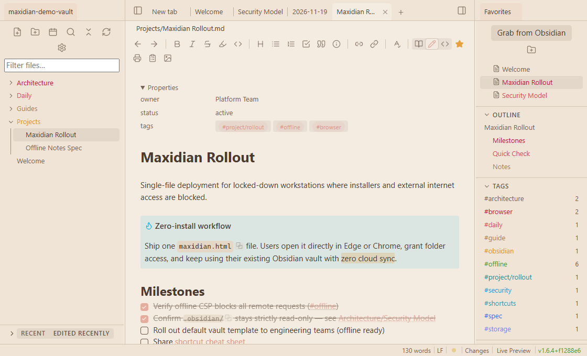
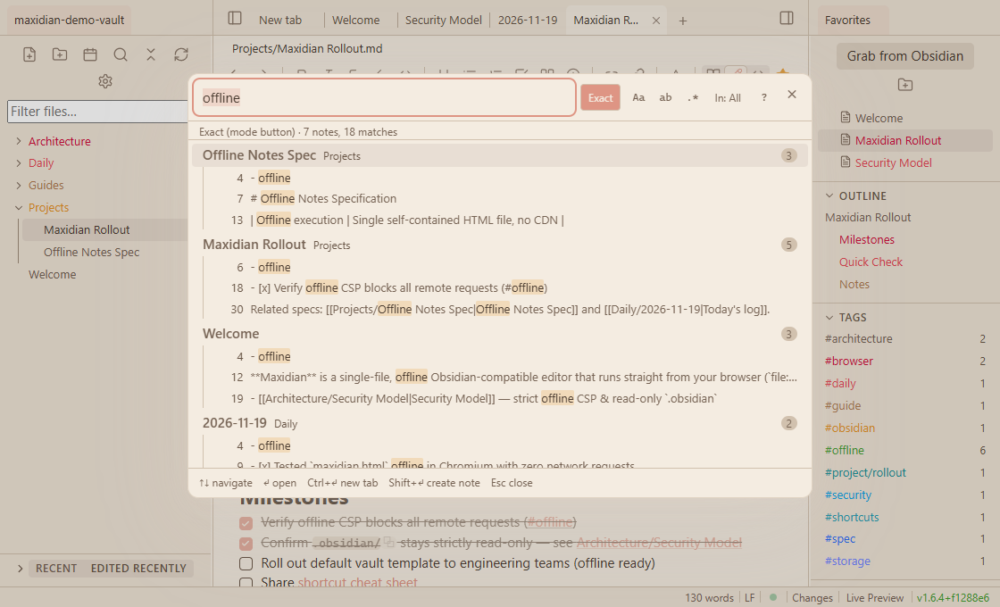

# Maxidian

A minimal, JUST ONE HTML FILE Obsidian-compatible Markdown editor that works directly in and from your browser (`file://`) - completely offline, with no installer, no server, and no network access. Built for locked-down or air-gapped machines with restricted internet access.

## Quick Start

1. Download or open [`maxidian.html`](https://github.com/MaxITService/Maxidian/releases/latest/download/maxidian.html) in **Edge** or **Chrome**.
2. Click **Open vault folder...**, select your local Obsidian vault, and grant folder access.
3. Read, edit, and search your notes in place - all offline.

> Your `.obsidian/` folder is strictly **read-only** in Maxidian. App settings, private favorites overrides, and recovery snapshots live in `.maxidian/`.

## Screenshots

### Editing (Live Preview)

### Search

## Features

- **Single HTML file, 100% offline** - zero dependencies, no CDN, no telemetry, CSP blocks remote resources.
- **Native Obsidian vault editing** - edits existing local folders in place via the File System Access API while keeping `.obsidian/` strictly read-only.
- **Reading & Live Preview editing** - CodeMirror 6 Live Preview, Source mode, formatting toolbar, `[[wikilinks]]`, `![[embeds]]`, callouts, frontmatter properties, highlights, `#tags`, checklists, and syntax-highlighted code blocks.
- **Fast fuzzy & exact search** - `Ctrl+O` full-text search with highlighted excerpts, folder scoping, `#tag` filtering, and double-`Ctrl` quick switcher.
- **Themes & layout** - Light Coffee default theme plus bundled AnuPpuccin (rainbow folders & Style Settings) and built-in palettes (Light Coffee, Dark Coffee, Pink Blossom, Claude), tabs with overflow menu, split panes, folder tree, favorites, outline, and backlinks.
- **Data safety** - verified read-back writes, external conflict detection, preserved `CRLF`/`LF` & UTF-8 BOM, local recovery snapshots with diff/restore, and `.trash` folder support.
- **Everyday workflow** - daily notes (`Alt+D`), drag-and-drop task/list reordering, paste formatted text/tables or images, rich-text copy, and multiple vaults via browser tabs.

## Other projects

- [AivoRelay](https://github.com/MaxITService/AIVORelay) — AI voice dictation and text-to-speech for Windows.
- [OneClickPrompts](https://github.com/MaxITService/OneClickPrompts) — reusable prompt buttons for AI chats.
- [Console2Ai](https://github.com/MaxITService/Console2Ai) — send a PowerShell buffer to AI.
- [Mouse & Key Studio](https://github.com/MaxITService/MouseKeyStudio) — Logitech device settings, button remapping and macros for Windows.
- [Ping-Plotter](https://github.com/MaxITService/Ping-Plotter-PS51) — a PowerShell ping plotting script.
- [AI for Complete Beginners](https://medium.com/@maxim.fomins/ai-for-complete-beginners-guide-llms-f19c4b8a8a79) — an introductory guide to LLMs.

## License

Maxidian is free software, licensed under the [GNU General Public License v3.0](LICENSE). Copyright (c) 2026 Maxim Fomin.

## Third-Party Licenses

Maxidian bundles open-source third-party libraries and themes directly inside `maxidian.html`. See [docs/LICENSES.md](docs/LICENSES.md) for the full list and license texts.
